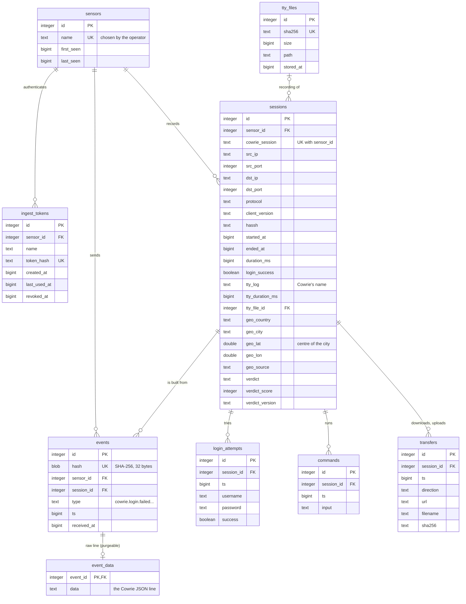
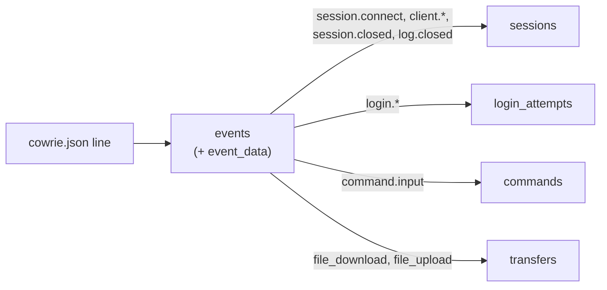

# Database

Status: **implemented**, replacing the schema of v0.0.1–v0.0.6 (breaking
change: no conversion, see "Upgrading from v0.0.x" in the README).

## Measured result

The same 39,983 real Cowrie lines (7,437 sessions) sent to both schemas
through the API, SQLite, databases vacuumed:

| | Before | After |
|---|---|---|
| Database | 55.4 MB | 40.4 MB |
| Events, with their raw lines and indexes | 48.9 MB | 37.4 MB (`events` 5.8, `event_data` 31.6) |
| Sessions, projections, their indexes | 6.5 MB | 3.1 MB |
| Left once raw lines are purged | (not possible) | 8.9 MB, 1.2 KB per session |
| Session list filtered by username | 995 ms | 3 ms |
| Ingestion | | 15,800 events/s |

Every other list query stays between 1 and 18 ms.

## Why a new schema

The first schema, measured on 7,437 real sessions (57 MB, about 7.7 KB per
session), has these problems:

| Problem | Effect |
|---|---|
| Ids are SHA-256 digests stored as 64 hexadecimal characters, used as primary and foreign keys | Keys 8 times larger than an integer; under SQLite a `TEXT` primary key is a second index beside the table (3.3 MB for `raw_events` alone) |
| Login attempts, commands and transfers have the id of their raw event as primary key, with a foreign key to `raw_events` | Raw events, 71 % of the database, cannot be purged without losing the projections |
| Times are stored as 32-character text under SQLite | Large, and ordering relies on every writer using the exact same format |
| Raw Cowrie lines are kept whole forever | 88 % of the database with its indexes; `cowrie.client.kex` alone is half of it |
| Unused or harmful indexes | `raw_events (eventid, ts)` serves no query (2.7 MB); `login_attempts (username)` makes the username filter of the session list quadratic (1 s at 7,437 sessions) |

## Principles

- **Integer primary keys everywhere**, generated by the database
  (`INTEGER PRIMARY KEY` in SQLite: the row id itself; `BIGINT GENERATED BY
  DEFAULT AS IDENTITY` in PostgreSQL).
- **Deduplication is a unique column, not the key.** The ingestor delivers
  at least once, so a resent Cowrie line must be recognised: `events.hash`
  (SHA-256 of sensor and line) is `UNIQUE`, used only at ingestion.
- **Times are integers**: microseconds since 1970-01-01 UTC, `BIGINT` in
  both engines. bun writes `time.Time` as text under SQLite (its dialect
  has no native time type), so a Go type converts `time.Time` to and from
  the integer. Ordering is always right, and grouping by hour or day for
  statistics is a portable division (`ts / 3600000000`).
- **Raw data is separate and purgeable**: `event_data` holds the Cowrie line,
  everything else points to `events`, which stays.
- **One set of migrations per engine**, so each uses its own types,
  applied by bun's `migrate` package (goose is dropped).
- **Every index serves a named query** (see [Indexes](#indexes)).

## Tables



### What each table is for

| Table | Role | Rows |
|---|---|---|
| `sensors` | The honeypots; `name` is the id the operator gives the ingestor | A few |
| `ingest_tokens` | Ingestor credentials, one or more per sensor; only the hash is stored | A few |
| `sessions` | One SSH or Telnet connection: the summary of its events, plus the location and verdict computed by the API | One per connection |
| `events` | One per Cowrie line: what happened, when, in which session; and the hash that recognises a line sent twice | 5 per session (measured) |
| `event_data` | The Cowrie line itself, to show it raw and to project it again; can be purged | One per event, until purged |
| `login_attempts` | Username and password tried, success or not | ~1 per session |
| `commands` | Commands typed or run | Few sessions, several each |
| `transfers` | Files downloaded (`wget`, `curl`) or uploaded (SFTP, SCP) | Rare |
| `tty_files` | Recordings stored in the TTY volume, by digest of the file | One per distinct recording |

### Sessions and events

Cowrie writes one JSON line per thing that happens, each carrying its
session id. The API keeps each line as an **event**, and derives from them:

- the **session** row: connection fields from `cowrie.session.connect`,
  client from `cowrie.client.version` and `cowrie.client.kex`, end and
  duration from `cowrie.session.closed`, recording from `cowrie.log.closed`;
- the **projections**: one row in `login_attempts` per
  `cowrie.login.success`/`failed`, in `commands` per `cowrie.command.input`,
  in `transfers` per `cowrie.session.file_download`/`file_upload`.



So `events.session_id` links each event to the session it belongs to; the
projections link to the session too, not to the event: they stay when raw
data is purged, and do not depend on how events are stored.

### Ingestion of a batch

In one transaction:

1. Upsert the sensor and the sessions named by the batch (merge rules
   unchanged: first value wins for connection fields, earliest start, etc.).
2. `INSERT INTO events ... ON CONFLICT (hash) DO NOTHING RETURNING id, hash`:
   only the lines not seen before come back, with their new ids.
3. For those only: insert `event_data` and the projections. A resent batch
   inserts nothing: ingestion stays idempotent without the projections
   needing the event's key.
4. Judge the touched sessions (verdict).

### Purging raw data

```sql
DELETE FROM event_data
WHERE event_id IN (SELECT id FROM events WHERE ts < :limit);
```

Sessions, events, projections and deduplication are untouched; only the
raw view of old events and their reprocessing are lost. Retention is an
operator setting, off by default: `CAURI_RAW_RETENTION_DAYS`, run at
start and every hour, in batches (`store.PurgeRawEvents`).

One feature still reads raw lines: replays take the terminal sizes from
`cowrie.client.size` lines (`store.GetRecording`). The purge keeps those
(`store.RawKept`); projecting them into their own table would remove the
exception.

## Foreign keys

Every foreign key is named `fk_<table>_<column>`, the same in both engines
(`TestForeignKeyNamesAndActions` reads them back), and says what removing
its parent does (migration 00005):

| Constraint | Parent | When the parent is deleted |
|---|---|---|
| `fk_ingest_tokens_sensor_id` | `sensors` | `CASCADE`: a token means nothing without its sensor |
| `fk_sessions_sensor_id` | `sensors` | `RESTRICT`: a sensor with sessions cannot be deleted by accident |
| `fk_events_sensor_id` | `sensors` | `RESTRICT`, as above |
| `fk_sessions_tty_file_id` | `tty_files` | `SET NULL`: removing a recording leaves its sessions, without it |
| `fk_events_session_id` | `sessions` | `CASCADE`: the events belong to the session |
| `fk_event_data_event_id` | `events` | `CASCADE`: the raw line follows its event |
| `fk_login_attempts_session_id`, `fk_commands_session_id`, `fk_transfers_session_id` | `sessions` | `CASCADE`: projections of the session |

So deleting a session takes its events, raw lines, logins, commands and
transfers with it, and to remove a sensor one first removes its sessions
(and so its events). `TestForeignKeyActions` runs these cases on both
engines. Every referencing column has an index, which the parent's
deletion needs (`sessions (tty_file_id)`, `events (sensor_id)`,
`ingest_tokens (sensor_id)`, migration 00005; the others were already
indexed).

SQLite cannot change a constraint in place: migration 00005 rebuilds the
six tables that hold one, under temporary names that refer to each other,
drops the old ones children first and renames the new ones, with foreign
keys on throughout (they cannot be switched off inside a transaction, and no
action reaches an old table once its children are gone). Tried on a copy of a
real database (2,949 sessions, 16,103 events), up, down and up again: same
rows, `foreign_key_check` empty.

## Types

| Value | SQLite | PostgreSQL | Go |
|---|---|---|---|
| Primary key | `INTEGER PRIMARY KEY` | `BIGINT GENERATED BY DEFAULT AS IDENTITY PRIMARY KEY` | `int64` |
| Foreign key | `INTEGER` | `BIGINT` | `int64` |
| Time | `INTEGER` (µs since epoch, UTC) | `BIGINT` | a `time.Time` wrapper |
| Coordinate | `REAL` | `DOUBLE PRECISION` | `float64` |
| Duration | `INTEGER` (ms, as Cowrie gives it) | `BIGINT` | `int64` |
| Boolean | `INTEGER` 0/1 | `BOOLEAN` | `bool` |
| Digest (`events.hash`) | `BLOB` (32 bytes) | `BYTEA` | `[]byte` |
| Text, addresses | `TEXT` | `TEXT` | `string` |

## Indexes

Each index, with the query it serves. Primary keys and `UNIQUE`
constraints are indexes too.

| Index | Query |
|---|---|
| `sensors (name)` unique | Find the sensor of a token or a batch |
| `ingest_tokens (token_hash)` unique | Authenticate an ingestor |
| `sessions (sensor_id, cowrie_session)` unique | Upsert a session at ingestion |
| `sessions (started_at)` | Session list, latest first |
| `sessions (sensor_id, started_at)` | Session list of one sensor |
| `sessions (src_ip)` | Filter by source address |
| `sessions (geo_country, geo_city)` | Country and city filters, country counts (migration 00002) |
| `sessions (verdict)` | Human/bot filter |
| `events (hash)` unique | Deduplication |
| `events (session_id, ts)` | Events of a session page |
| `login_attempts (session_id)` | Logins of a session; credentials in the list |
| `login_attempts (ts)` | Failed logins list, latest first |
| `login_attempts (username, session_id)` | Username filter, without the quadratic plan |
| `commands (session_id)` | Commands of a session |
| `transfers (session_id)` | Transfers of a session |
| `transfers (sha256)` | Payloads by digest, sessions that transferred a file (migration 00003) |
| `tty_files (sha256)` unique | Find a recording by digest at upload |
| `sessions (tty_file_id)` | Sessions of a recording; deleting a recording (migration 00005) |
| `events (sensor_id)` | Deleting a sensor checks its events (migration 00005) |
| `ingest_tokens (sensor_id)` | Tokens of a sensor; deleting a sensor (migration 00005) |

Dropped from the first schema: `raw_events (eventid, ts)` (no query) and
`sessions (tty_sha256)` (no query found; to add back when a feature
needs it). `transfers (sha256)` came back with the payloads page.

## Migrations

bun's `migrate` package (already part of the bun module) replaces goose:
it reads `up` and `down` from separate files, and adds no dependency. One
directory per engine, embedded in the binary, applied at API start:

```
internal/store/migrations/
├── sqlite/
│   ├── 00001_init.tx.up.sql
│   └── 00001_init.tx.down.sql
└── postgres/
    ├── 00001_init.tx.up.sql
    └── 00001_init.tx.down.sql
```

- `.tx` in every name: each migration runs in a transaction, so none is
  ever half applied.
- `WithMarkAppliedOnSuccess(true)`: by default bun marks a migration as
  applied *before* running it, so a failed one would count as done.
- No `Lock`: bun's lock is a row in a table, left behind if the API dies
  while migrating, which then blocks every start. cauri runs one API per
  database; a real lock comes with the first need for several.

The two directories must describe the same tables, columns and indexes:
a test compares the schema read back from both engines.

## Decisions

- **Upgrade from v0.0.x**: none. The new schema starts clean (breaking
  change); existing users re-ingest from `cowrie.json` by resetting the
  ingestor's position. The API refuses to start on a v0.0.x database
  (goose's `goose_db_version` table present) with a message saying so,
  rather than creating new tables beside the old ones.
- **`events.type`**: text, as Cowrie names its events.
- **Retention of `event_data`**: later. `cowrie.client.kex` lines (the
  client's SSH algorithm lists, about half of the raw volume; their HASSH
  fingerprint is already in `sessions.hassh`) will be part of that
  discussion.

## Statistics at scale

Statistics are computed on read from the tables above. Measured on
SQLite with the real sessions replicated to 96,681:

| Endpoint | Time |
|---|---|
| `/api/stats/summary`, `activity`, `commands`, `payloads` | 23–72 ms |
| `/api/stats/origins`, `/api/countries`, `/api/cities` | 65–139 ms |
| `/api/stats/credentials` | 570 ms (several groupings of every login attempt) |
| Session list, filtered or not | 13–40 ms |
| `/api/attackers` (sessions grouped by address, 3,564 attackers) | 64–196 ms |
| `/api/attackers/{ip}`, statistics of one address | 2–6 ms |

The cost grows with the number of rows: around a million sessions,
credentials would take seconds. The next step is then summary tables
kept up to date at ingestion (counts by day, by username, by password),
not a different database.

## Consequences

- Session URLs are `/sessions/{integer}`: not the same after a rebuild
  of the database.
- The read API names the sensor in `sensor`; durations are
  `duration_ms` and `tty_duration_ms`.
